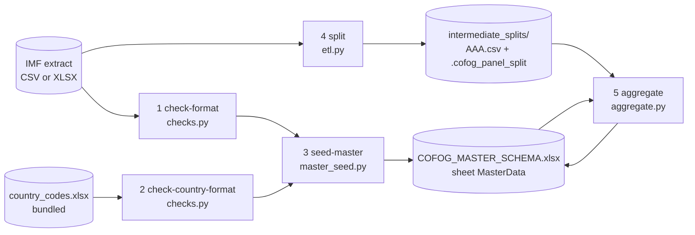

# Architecture

How `cofog_panel/` turns one IMF GFS COFOG download into columns of a country-year panel.
`README.md` is the spec (selection rule, tiers, columns, options); this file maps the spec to the code.

## Pipeline

`cli.py` is a Typer app. Each stage is a command; `run` chains all of them.



| # | Command | Module | Reads | Writes |
|---|---------|--------|-------|--------|
| 1 | `check-format` | `checks.verify_cofog_format` | header row of the extract (extra columns warn, missing ones fail) | report only |
| 2 | `check-country-format` | `checks.verify_country_format` | lookup file | report only |
| 3 | `seed-master` | `master_seed.seed_master` / `prepare_master` | lookup | `output/COFOG_MASTER_SCHEMA.xlsx` (SortKey, Country, Year) |
| 4 | `split` | `etl.split_data` | extract (one streaming pass) | one `AAA.csv` per country + marker file |
| 5 | `aggregate` | `aggregate.run_aggregation` | master + split dir | 4 new columns in the master |

Look-up commands `list-cofog` (`etl.list_cofog`) and `list-sectors` read nothing, or the extract once.

Stage numbers follow the `[Stage n/5]` log lines and module docstrings. `AGENTS.md` numbers them differently (it merges the two checks into stage 1).

## Modules

| Module | Role | Depends on |
|--------|------|------------|
| `cli.py` | Typer commands, shared option types, `_guarded` error wrapper, exit codes | all others |
| `options.py` | Validate `--cofog` (codes outside the built-in list also against the extract's series codes), `--filter-type` before the scan; `COFOG_LABELS`; `data_column_for` | `source` (lazily) |
| `source.py` | `open_rows`: one row iterator over CSV or XLSX; `header_row`; `default_source` (xlsx preferred) | openpyxl |
| `checks.py` | Header and lookup validation; `IMF_METADATA_COLUMNS` | `source`, `messages` |
| `master_seed.py` | Build the panel (ISO3 x years); keep or rebuild an existing master | `checks.read_lookup` |
| `etl.py` | Filter by transformation + COFOG; write per-country files; split marker; list countries missing from the lookup; `IMF_TO_ISO` (from `data/imf_country_codes.csv`) | `source`, `options`, `checks` |
| `aggregate.py` | Selection rule, completeness flag, write master | `etl` (`COUNTRY_FILE_PATTERN`), `messages` |
| `messages.py` | `print_error` two-line format, shared hints | none |
| `provenance.py` | `record_run`: the sheet `Provenance` of the master (one row per function and run: version, source SHA-256 and size, `PUBLICATION_DATE`, command and options, UTC time, columns created); `read_provenance` | `aggregate` (column names) |
| `api.py` | `build_panel`: the five stages in a temporary folder, the master returned as a tidy DataFrame with the provenance columns and `attrs["provenance"]` | the stage modules, `provenance` |
| `gui.py` | Streamlit page (`main()`), started by `cofog-panel gui` or the root shim `gui.py` | the stage modules, `provenance`, streamlit |

## Data model

- **Extract**: ~372k rows, one per series. Used columns: `SERIES_CODE` (country = first dot-field, kept only if three letters, COFOG = 4th dot field, e.g. `GF0510_T` -> `05.1`; the extract also carries series of other indicators, total outlays `TOA_T`/`TOTOUT_T` and a liability series, with an empty `COFOG` label, which `split` skips without counting them as rows without a function), `TYPE_OF_TRANSFORMATION`, `COFOG` (label), `SECTOR`, year columns 1972+.
- **Master**: sheet `MasterData`, key `SortKey = ISO3 + year` (`ARM2019`); `run`, the GUI and `build_panel` add the sheet `Provenance` (`provenance.record_run`) after stage 5, and keep its rows from earlier runs. Default years 1972-2025. IMF codes `KOS`, `WBG` map to `XKX`, `PSE` (`IMF_TO_ISO`).
- **Split directory**: `AAA.csv` per country (UTF-8 with BOM; `etl.country_files` also finds `AAA.xlsx` from splits made up to 1.0.5, CSV preferred), plus `.cofog_panel_split` recording `cofog=`, `transformation=`, `publication_date=` (selected series, comma-separated if several) and `years=FIRST-LAST`. `etl` deletes country files only in a directory that has the marker (or is empty). `aggregate` reads the marker to name the data column.
- **Output columns** per indicator, suffix from the COFOG code (`DATA_05`, `DATA_07_3`): data, `SOURCE_TIER_<s>`, `SOURCE_SECTORS_<s>`, `SOURCE_COMPLETE_<s>`. `DATA_NEW` keeps unsuffixed names. Naming lives in `aggregate._suffix`, `tier_column`, `provenance_columns`, and `options.data_column_for`.

## Selection rule (`aggregate.py`)

`resolve_value(values, sector_override, zero_as_missing, summable)` is pure: sector name -> `Decimal | None` in, `(value, tier, sectors)` out.

```
General government (default)
  GG reported                      -> T1
  else CGSS reported               -> T2 = CGSS + SG + LG
  else                             -> T3 = (CGXSS | BCG+EBCG) + SSF + SG + LG
Central government incl. social security
  CGSS reported                    -> C1
  else                             -> C2 = (CGXSS | BCG+EBCG) + SSF
Any single sector                  -> D
```

- `summable=False` (any transformation other than Percent of GDP / Domestic currency, or Domestic currency with differing `SCALE`/`UNIT`/`CURRENCY` between the series of a country) allows T1, C1, D only. Shares of total outlays are never summed.
- `zero_as_missing` drops zeros in every sector before the rule runs.
- `check_ranges` (opt-in) only reports negative values and percentages above 100 after selection; it never changes a value.
- `is_complete(tier, used, levels_reported, values)` gives the `Y/N` flag: a fallback sum is complete when it includes every level (EBCG, SSF, SG, LG) the country reports in at least one year. T1 is flagged `N` when GG equals CGSS exactly while SG or LG spend more than zero.
- Sums use `Decimal` at precision 50; a directly reported value is written with its original text.

Per country: `_read_country_file` (first series per sector, warns when later series differ; summable check) -> `_levels_reported` -> `_select_for_country` loops years -> dict `{SortKey: (value, tier, sectors, Y/N)}`. `run_aggregation` merges dicts, maps onto master rows by `SortKey`, rewrites the whole sheet, restores numeric types with `_restore_types`.

## Error handling

- Every user-facing error = `❌ Error:` line + `Hint:` line (`messages.print_error`).
- Exit codes: 0 success, 1 data or option error, 2 usage error (Typer).
- Option checks (`options.py`) run before the slow scan; they raise `OptionError(what, hint)`. `cli._guarded` converts it, and any unexpected exception, into the two-line format. `--debug` re-raises.
- Stage functions return `(path, ok)` or `bool` instead of raising; `cli.py` turns `False` into `typer.Exit(1)`.
- `click` is never imported; `_TYPER_EXCEPTIONS` finds Typer's exception bases through `typer.BadParameter.__mro__` (works for Typer 0.18 to 0.27+).
- `cli.py` reconfigures stdout/stderr with `errors="replace"` for legacy Windows consoles.

## Master lifecycle

| Command | Existing master |
|---------|-----------------|
| `seed-master` | replaced (warning) |
| `run` | kept; new columns added. `--overwrite-master` rebuilds it (warning) |
| `aggregate` | same-named columns replaced (warning), others kept |

`--start-year`/`--end-year` apply only when a master is created.

`run` with several `--cofog` values runs stages 1-3 once and stages 4-5 per function, splitting into `<split-dir>/<code>`; the master is shared, so the result equals one `run` per function.

## Tests

`tests/test_aggregate.py`: selection rule, completeness, stage-level pipeline on a synthetic extract. `tests/test_cli.py`: provenance naming, `run` master handling, option validation. `tests/test_usability.py`: defaults, CSV vs Excel, error messages and exit codes. `tests/test_gui.py`: runs `gui.py` with Streamlit's AppTest (skipped without the `gui` extra). CI: ubuntu/windows/macos x Python 3.10/3.12/3.14, a job with `.[dev,gui]` (Python 3.12) so that the GUI tests run, plus oldest and newest Typer.

## Outside the package

`replication/harmonisation/`, `replication/environment/`: scripts reproducing published analyses, each with its own README. Selection-rule changes alter their numbers; rerun and state whether outputs changed. `cofog.ipynb`: notebook demo. `cofog_panel/gui.py` (root `gui.py` is a shim for `streamlit run gui.py` and the launchers): optional Streamlit page (extra `gui`, Streamlit 1.49 or later) that calls the same stage functions as `cli.run` for one built-in function with the default column names; each run works in a new temporary folder, so it always builds a new master (no `--overwrite-master` to offer). Launched by `run_gui.sh` / `run_gui.bat`. The code is MIT-licensed (`LICENSE.txt`); IMF data is not (`DATA_LICENSE.md`).
